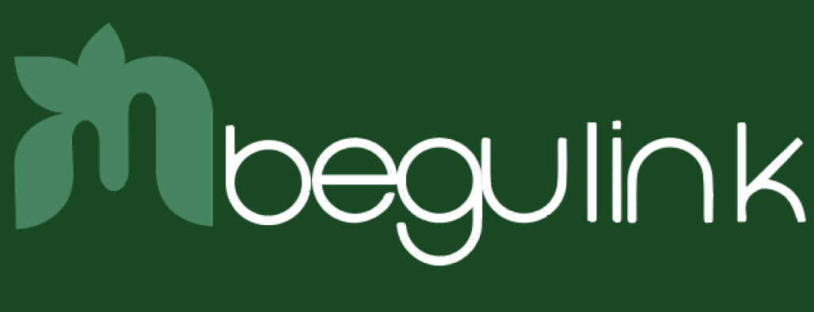
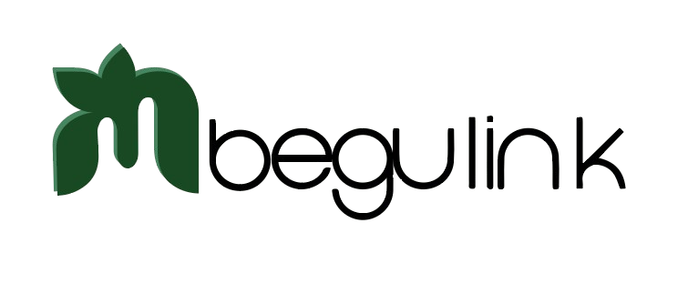
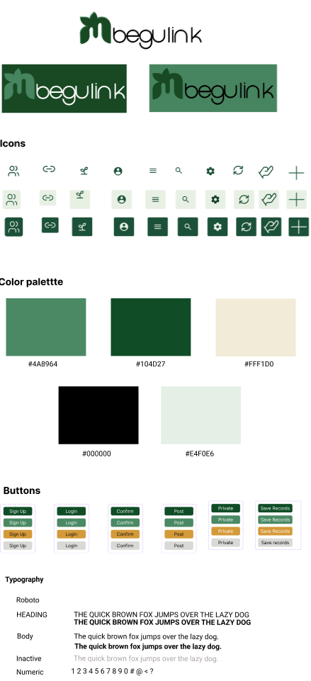
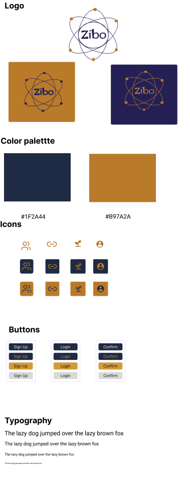
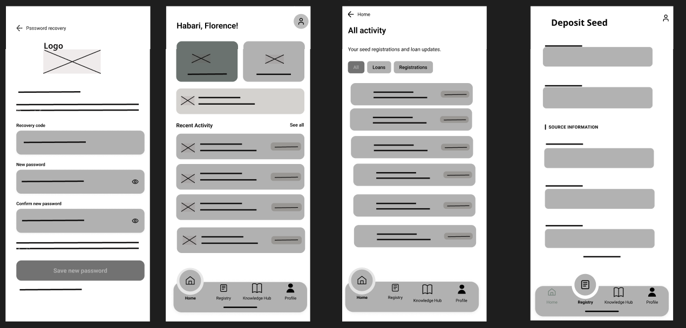
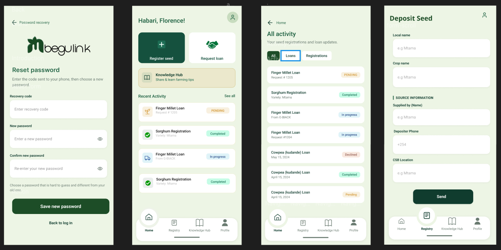
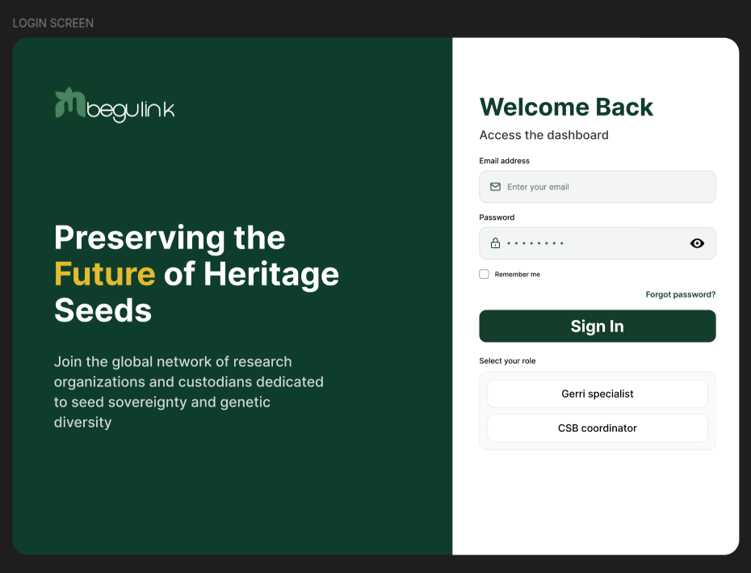

# Design System

This page records the visual language of Mbegu Link and shows how it appears in the interfaces. It connects the Figma design file to what gets built, so developers, reviewers and partners work from the same logos, colours, type, icons and screens.

## Figma source file

Logos, style guides, wireframes and final screens are all kept in Figma.

[Open the Zibo design file in Figma](https://www.figma.com/design/HzXMTo0tqeXmOuVRtQwnNr/Zibo?node-id=25-69&p=f&t=vZ01x7cplEtJCa71-0){ .md-button .md-button--primary target="_blank" }

---

## 1. Logos

Two identities are used. **Mbegu Link** is the product that custodians, coordinators and GeRRI specialists use. **Zibo** is the team behind it (Group Zibo, AkiraChix).

### Mbegu Link (product)

The mark is a leaf-shaped **M**. Together with the lowercase wordmark it reads *Mbegu Link*. It is supplied in versions for dark and light backgrounds.

| For dark backgrounds | For light backgrounds |
|:---:|:---:|
| 

 | 

 |
| `logo-in-white.png` | `logo-in-black.png` |

The default logo (`logo.png`) is the dark-background version and is used in the header of this site.

### Zibo (team)

The Zibo mark, an atom-style ring around the team name, identifies the team rather than the product. Its colours and variations are shown in [section 2](#zibo-team-style-guide).

---

## 2. Style guide

### Mbegu Link product style guide

<figure markdown>
  { width="400" }
  <figcaption>Mbegu Link style guide: logo, icons, palette, buttons and typography.</figcaption>
</figure>

### Zibo product style guide

<figure markdown>
  { width="400" }
  <figcaption>zibo Link style guide: logo, icons, palette, buttons and typography.</figcaption>
</figure>

#### Colour palette

| Swatch | Hex | Where it appears in the screens |
|:---:|:---|:---|
|  | `#104D27` | Primary buttons, the dark panel on the web login, active navigation |
|  | `#4A8964` | The logo mark, secondary buttons, icon tiles |
|  | `#E4F0E6` | Mobile app background |
|  | `#FFF1D0` | Soft highlight cards such as the Knowledge Hub shortcut |
|  | `#000000` | Text and the black logo version |

#### Typography

The product uses the **Roboto** family. The style guide defines four text styles:

| Style | Use |
|:---|:---|
| **Heading** | Screen titles such as *Deposit Seed* and *All activity* |
| **Body** | Form labels, descriptions and list content |
| **Inactive** | Disabled fields and placeholder text, shown in a lighter grey |
| **Numeric** | Quantities, request numbers and dates |

#### Buttons

Each button type appears in four states. Labels shown in the guide include *Sign Up*, *Login*, *Confirm*, *Post*, *Private* and *Save Records*.

| State | Appearance |
|:---|:---|
| Primary | Dark green fill with white text |
| Secondary | Mid green fill |
| Accent | Amber fill, for actions that need attention |
| Disabled | Grey fill, not clickable |

#### Icons

Ten line icons cover the main concepts: people, link, sprout (seed), profile, list, search, settings, sync, handshake-leaf (loan) and add. Each icon comes in three treatments: plain, soft tile and solid tile.

### Zibo team style guide

<figure markdown>
  { width="300" }

]=ofigcaption>Zibo team style guide: logo, palette, icons, buttons and typography.</figcaption>
</figure>

| Swatch | Hex | Role |
|:---:|:---|:---|
|  | `#1F2A44` | Navy, the team's primary colour |
|  | `#B97A2A` | Gold, the team's accent colour |

---

## 3. Product interfaces

Mbegu Link has two clients built on one design language: a **mobile app** for seed custodians and a **web dashboard (PWA)** for CSB coordinators and GeRRI specialists. See [Mobile](mobile.md) and [Frontend Web](frontend.md) for how each is built.

### Mobile app

The mobile app is designed for custodians recording seed in the field. The design moved from grayscale wireframes to the final screens.

#### Wireframes

<figure markdown>
  
  <figcaption>Grayscale wireframes: layout and flow before colour and branding.</figcaption>
</figure>

#### Final screens

<figure markdown>
  
  <figcaption>Final mobile screens, left to right: password recovery, home, all activity, deposit seed.</figcaption>
</figure>

| Screen | Purpose | Key elements |
|:---|:---|:---|
| **Password recovery** | Reset a forgotten password | Recovery code sent to the phone, new password, confirm password |
| **Home** | Starting point after sign-in | Greeting, *Register seed* and *Request loan* actions, Knowledge Hub shortcut, recent activity |
| **All activity** | Review seed registrations and loans | Filters for All, Loans and Registrations, status labels on each item |
| **Deposit Seed** | Register seed with its source | Local name, crop name, source information (supplied by, depositor phone), CSB location, Send |

All four screens share a bottom navigation bar with **Home**, **Registry**, **Knowledge Hub** and **Profile**.

### Web dashboard

The web dashboard serves CSB coordinators and GeRRI specialists. The login screen pairs a dark green brand panel with a white sign-in form.

<figure markdown>
  
  <figcaption>Web dashboard login: "Welcome Back", with a role selector for GeRRI specialist and CSB coordinator.</figcaption>
</figure>

---

## 4. Request status colours

Requests move through Pending, In Progress, Completed and Declined. Each status uses a fixed pair of colours so people can recognise it at a glance, as documented for the mobile app.

| Status | Background | Text |
|:---|:---:|:---:|
| Pending |  `#FFF3D6` |  `#8A6800` |
| In progress |  `#E7F5E7` |  `#1D6B4B` |
| Completed |  `#E2F7EB` |  `#126B48` |
| Declined |  `#FDECEC` |  `#B42318` |

---

## 5. This documentation site

This site has its own look, chosen for reading. It is separate from the product palette above.

| Swatch | Hex | Use on this site |
|:---:|:---|:---|
|  | `#EDF5E5` | Page background |
|  | `#004F2E` | Header, page titles |
|  | `#228B22` | Section headings, links |
|  | `#A8D84E` | Small accents |

---

## 6. Implementation notes

- Mobile design tokens live in `lib/core/widgets/theme.dart` and `lib/core/constants/loan_status.dart` (see [Mobile](mobile.md)).
- Web tokens and component choices are described in [Frontend Web](frontend.md).
- Confirm each hex value against Figma before using it in code. This documentation does not include the product source code, so it does not claim that the values above match the current build.