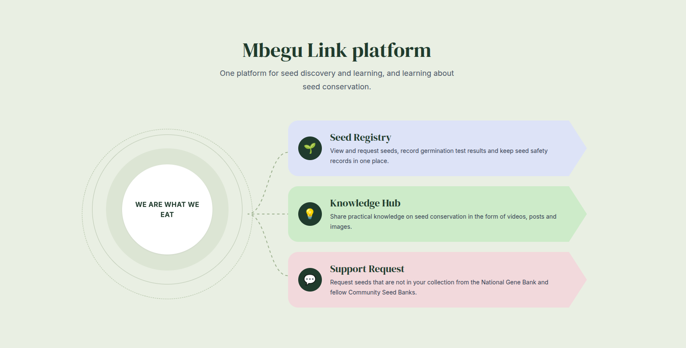

# Strengthening Indigenous Seed Conservation Systems in Kenya

  

    
  

  

    <button onclick="revealContent()" style="background-color: #e6e8e7; color: #092c1e; padding: 3px 5px; font-size: 1.25rem; border-radius: 6px; border: none; font-weight: 600; cursor: pointer; transition: transform 0.2s;" onmouseover="this.style.transform='scale(1.03)'" onmouseout="this.style.transform='scale(1)'">Get Started &rarr;</button>
  

  <button class="lightbox__close" id="startLightboxClose" aria-label="Close">×</button>
  

## Technical Overview

This documentation portal serves as the single source of truth for the Mbegu Link ecosystem architecture, tracking the development of our Minimum Viable Product (MVP). Mbegu Link is a community-controlled digital platform that gives Community Seed Banks (CSBs), seed custodians and Kenya’s national genebank one seed record that stays connected as seed moves making seed identity, condition, movement and support needs visible so that communities can conserve seed over the long term and reach the right institution when they need help.

### What We Do

Mbegu Link builds the information bridge between community seed conservation and formal conservation institutions. We provide the tools through which community seed custodians record their seed varieties once, properly, and keep those records alive as the seed moves, is tested, regenerated or shared. When a variety becomes vulnerable, the platform provides a defined pathway for a Community Seed Bank to request conservation support additional storage, safety duplication, documentation or technical help from the Genetic Resources Research Institute (GeRRI) or from partner CSBs.

We are deliberate about what Mbegu Link is not. It does not replace genebank systems such as GGCE and Genesys, and it does not replace community practices. It complements them. It is a decision-support tool: it records and reminds, while people make the conservation decisions.

### Background: The Problem We Address

Smallholder farmers produce most of Kenya’s food and obtain approximately 75–80% of their seed through farmer-managed seed systems. Community Seed Banks play a critical role in conserving locally adapted varieties, while GeRRI provides long term conservation through formal documentation, viability monitoring and safety duplication. Despite shared goals, these institutions operate largely independently.

Our field research site visits to CSHEP (Kiserian, Kajiado County) and G-BIACK (Thika, Kiambu County) under the PELUM Kenya network, together with an expert interview with the Head of Genebank Information Systems at the Crop Trust identified the core failure pattern. The problem is not that communities fail to conserve seed; it is that the information their conservation depends on is fragile:

*   **Seed information exists, but only on the container:** Seed type, source, storage date and depositor contact are written on handwritten labels attached to bottles. There is no record book, no database, nothing beyond the label.
*   **Every transfer restarts the record:** Seed sent to another branch travels with a paper note; the receiver must re-test germination and re-record everything from scratch, because there is no way to know how long or under what conditions the seed was stored before.
*   **No known route to the genebank:** Field participants did not know how to deposit seed at GeRRI or what the process requires. Support flows through personal relationships and project funding, not established pathways.
*   **Safety duplication is informal and invisible:** Multiplying endangered seed and distributing it to trusted farmers is a real backup measure but it is completely undocumented, so nobody can see which varieties are duplicated or where.
*   **Ambient storage limits planning:** Seed is held at 21–25°C with no cold storage, so custodians plan for only about three years of viability.

The result: when seed moves between stakeholders, a variety’s history and genetic identity become difficult to reconstruct. This complicates decisions on testing, regeneration, duplication and formal conservation support leaving vulnerable varieties at risk of unnoticed decline.

### Our Approach

We took an evidence first, community controlled approach. The platform design responds directly to documented field findings rather than assumptions:

*   **Build on existing practice, do not replace it:** The communities we studied already follow sound practices oldest stock planted first, visual quality control through clear jars, organic protectants such as diatomaceous earth and wood ash, and clear germination rules (above 75% growth is approved for storage; below goes to consumption). Mbegu Link records what these practices produce instead of imposing formal genebank standards, which our literature review shows should not be transferred to CSBs unchanged.
*   **Community ownership is an architectural requirement:** Seed information can include farmer identities, indigenous knowledge and collection locations. Not all of it should be discoverable. Each CSB owns its records; GeRRI specialists see only the records a CSB has explicitly linked to a support request; knowledge entries are private by default; and making knowledge public is a deliberate, consented step.
*   **Records carry their own trust signals:** Every record shows its age (“last tested 14 months ago”), its data owner, its current custodian and its provenance. Nothing is silently deleted stale or corrected information is flagged and preserved as history.
*   **Seed is biological, not ordinary stock:** Regeneration, testing and duplication are recorded as dated events, so earlier results are never overwritten and a falling germination trend stays visible.

### The Product

The MVP serves three user roles across two interfaces, and is organised into four connected modules.
Link to our MVP — <a href="https://docs.google.com/document/d/10QJX-LUuQKx9csgsr-sYWJ_xtD9zy8bH4WUPME0hNUM/edit?tab=t.0" target="_blank" rel="noopener noreferrer">View MVP in Google Doc</a>
*   **Users:** Seed custodians use a mobile app to register seed varieties with local names, submit borrowing requests and read knowledge entries. CSB coordinators use a Progressive Web App to manage the master registry, record germination tests, configure community-agreed thresholds, review movement requests and initiate conservation support. GeRRI seed conservation specialists use a secure institutional PWA to review shared records and approve, reject or coordinate assistance requests.
*   **Modules:** 
    1. *Seed Registry* seed records with local and community names, source, quantity, responsible CSB, current custodian, and each seed’s full testing history as dated events.
    2. *Seed Movement* structured loan, sharing and transfer requests moving through Pending → Approved/Declined → In Progress → Completed, with custody rules for real-world cases: unconfirmed transfers, seed lost in transit, partial transfers and declines with reasons.
    3. *Knowledge Sharing* a Knowledge Hub where CSBs record and share growing, storing and seed-saving knowledge in local languages, with private, organisation and public visibility levels and withdrawal rights.
    4. *Conservation Attention & Coordination* threshold-based attention flags in the coordinator view, and a defined support-request pathway from a flagged CSB to GeRRI review and response.
*   **Technical Foundations:** A FastAPI backend over a relational database of eight tables (users, organisations, seed registry, events, requests, knowledge entries, media files, audit logs), with photos and videos in dedicated media storage. Access control is enforced server-side with role-based permissions; accounts are verified through CSB invitation codes and phone OTP; passwords are stored only as hashes; data is encrypted in storage and in transit; and the backend writes append-only audit logs for every module. An export and API layer is planned for future integration with GGCE and Genesys, subject to confirming the technical pathway with the institutions concerned.

The genuinely hard problems are not the registry itself they are identity (linking community identifiers to genebank accession numbers), sustained data entry, and institutional acceptance. Our technical effort focuses there.

### Standards and Compliance

The data model is designed as an active part of the conservation intervention, not a secondary technical concern. Mbegu Link aligns with the Multi-Crop Passport Descriptors (MCPD) standards from Bioversity International and FAO to map a sample’s biological pedigree; preserves local and indigenous variety names as first class metadata alongside scientific taxonomy; and treats community consent, access and benefit sharing (per the Nagoya Protocol) and indigenous data sovereignty as structural dependencies of the architecture. Compliance baseline: Kenya Data Protection Act 2019.

### Project Layout

*   [Product Overview](overview.md) — Platform objectives, target constraints, and field findings from CSHEP and G-BIACK.
*   [Getting Started](getting-started.md) — Core functional scope, design continuities, and development onboarding.
*   [System Architecture](architecture.md) — High-level system context, data-flow boundaries, and cybersecurity design models.
*   [Technical Specifications](backend.md) — Microservice interfaces, schema mappings, and multi-tenant isolation layers.
*   [Client Portals](frontend.md) — Progressive Web Application specifications for institutional stakeholders and mobile client design parameters.

## Project Status

*   **Product Version:** MVP (In Development)
*   **Target Release:** October 2026
*   **Core Team:** Group Zibo :Kudakwashe Paradza,
                              Andikonda Zulu,
                              Adeline Mugisha, &
                              Dorcus Wanjiru Njoroge
*   **Compliance Baseline:** Kenya Data Protection Act 2019, 2021 National Genebank-CSB Collaboration Protocol

